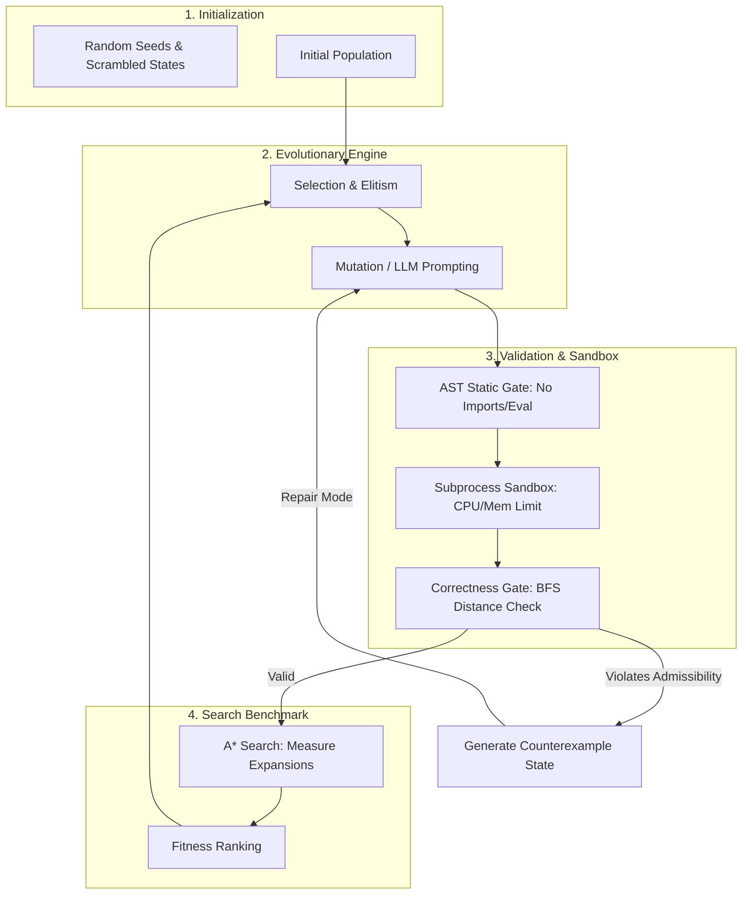

# Correctness-Aware Evolutionary Design of 8-Puzzle Heuristics

[](https://www.python.org/)
[]()
[](https://fastapi.tiangolo.com/)
[](https://streamlit.io/)
[]()

> **Academic Topic Classification:** *Heuristic Optimization using Genetic Algorithms / Evolutionary Computation in Artificial Intelligence*

An end-to-end framework for synthesizing, optimizing, and evolving admissible and consistent heuristic functions for the **8-Puzzle** using both **Classical Genetic Algorithms** and **Correctness-Aware Large Language Model (LLM) Evolution**.

---

## 📌 Table of Contents
- [Overview](#-overview)
- [Key Features](#-key-features)
- [Theoretical Foundations](#-theoretical-foundations)
- [System Architecture](#-system-architecture)
- [Repository Structure](#-repository-structure)
- [Quick Start & Installation](#-quick-start--installation)
  - [1. Offline Genetic Algorithm (No LLM Required)](#1-offline-genetic-algorithm-standalone)
  - [2. LLM-Guided Evolutionary Search](#2-llm-guided-evolutionary-search-optional)
  - [3. Interactive Web Dashboard & Backend](#3-interactive-web-dashboard--backend)
- [Experimental Evaluation & Statistical Tests](#-experimental-evaluation--statistical-tests)
- [Configuration](#-configuration)
- [License](#-license)

---

## 📖 Overview

The **8-Puzzle** is a classical benchmark problem in Artificial Intelligence with $181,440$ reachable states. The performance of the $A^*$ search algorithm is dictated by the quality of its heuristic function $h(s)$:
- An **admissible** heuristic ($h(s) \le h^*(s)$) guarantees finding an optimal solution.
- A **consistent** heuristic ($h(s) \le c(s, s') + h(s')$) prevents redundant state expansions.

Designing highly informative heuristics by hand requires domain expertise. This repository implements two complementary evolutionary approaches:
1. **Offline Genetic Algorithm Surrogate (`experiment.py`)**: A deterministic, dependency-free evolutionary search optimizing convex combinations of established admissible heuristics (Manhattan distance, Misplaced tiles, Linear conflict).
2. **Correctness-Aware LLM-Guided Evolutionary Search (`llm_experiment.py`)**: Couples local LLMs (e.g., Qwen 3 via Ollama) with genetic search operators, sandboxing, and formal mathematical verification to discover novel executable Python heuristics.

---

## ⚡ Key Features

- **Dual-Engine Evolutionary Search**:
  - **Deterministic GA Engine**: Uses selection, elitism, and continuous mutation to evolve weight distributions over basis heuristics without external API dependencies.
  - **Semantic LLM Evolution**: Employs local open-weights language models as genetic crossover/mutation operators to generate raw Python heuristic code.
- **Strict AST & Subprocess Sandbox**:
  - Static AST analysis forbids malicious or slow operations (`eval`, `exec`, `open`, external imports, reflection, state mutation).
  - Candidates execute inside isolated child processes with memory and CPU resource caps.
- **Exhaustive Mathematical Correctness Gating**:
  - Pre-computes exact shortest path distances via Breadth-First Search (BFS) across all $181,440$ reachable states.
  - Automatically flags and rejects **inadmissible** ($h(s) > d(s)$) and **inconsistent** candidates.
- **Counterexample-Driven Self-Repair**:
  - When an evolved candidate violates admissibility or consistency, the gate extracts the exact violating puzzle state as a concrete counterexample and prompts the model to self-repair.
- **Full Reproducibility & Statistical Rigor**:
  - Non-parametric **Wilcoxon signed-rank tests** with rank-biserial effect sizes.
  - Comprehensive logging of tokens, latencies, random seeds, and candidate genealogies.
- **Interactive UI & API**:
  - Includes a **Streamlit** dashboard and a **FastAPI** backend for executing and visualizing runs.

---

## 🔬 Theoretical Foundations

### 1. $A^*$ Search & Heuristic Constraints
For state $s$, goal state $g$, and legal transition $s \to s'$ with step cost $c(s, s') = 1$:
* **Admissibility**:
  $$\forall s, \quad 0 \le h(s) \le h^*(s)$$
  *(where $h^*(s)$ is the true shortest distance to $g$)*
* **Consistency (Triangle Inequality)**:
  $$\forall s, s', \quad h(s) \le 1 + h(s') \quad \text{and} \quad h(g) = 0$$

### 2. Genetic Algorithm Pipeline
The evolutionary lifecycle proceeds through:
1. **Population Initialization**: Seeded with known baselines and random convex combinations or LLM-generated heuristics.
2. **Fitness Evaluation**: Evaluated lexicographically:
   $$\text{Fitness} = (\text{Validity}, \text{Solved Count}, -\text{Mean Expansions}, -\text{Runtime}, -\text{AST Complexity})$$
3. **Selection**: Elitism maintains top-performing valid heuristics; tournament and diversity preservation prevent population stagnation.
4. **Offspring Generation & Mutation**:
   - In `experiment.py`: Bounded continuous perturbation with re-normalization.
   - In `llm_experiment.py`: Semantic mutation (improve prompt) or counterexample feedback (repair prompt).

---

## 🏗 System Architecture



---

## 📁 Repository Structure

```text
.
├── experiment.py            # Offline Genetic Algorithm surrogate (0 LLM calls, standalone)
├── llm_experiment.py        # Real LLM evolutionary runner with sandbox & correctness gates
├── llm_config.json          # Configuration for models, seeds, depths, and populations
├── pilot_result.json        # Logged output of single-shot pipeline smoke verification
├── backend.py               # FastAPI backend for triggering runs and serving results
├── app.py                   # Streamlit frontend visualizing heuristic performance
├── results.csv              # Baseline results from offline runs
├── statistical_tests.json   # Statistical evaluation metrics (Wilcoxon signed-rank test)
├── Dockerfile               # Container definition for API and UI services
├── requirements.txt         # Project Python dependencies
└── README.md                # Project documentation
```

---

## 🚀 Quick Start & Installation

### Prerequisites
- Python 3.10 or higher
- *(Optional, for LLM mode)* [Ollama](https://ollama.com/) with `qwen3:4b` installed.

### Installation
Clone the repository and install the dependencies:
```bash
git clone https://github.com/your-username/aies-heuristic-evolution.git
cd aies-heuristic-evolution
pip install -r requirements.txt
```

---

### 1. Offline Genetic Algorithm (Standalone)
To run the deterministic Genetic Algorithm on 5 random seeds (requires only standard Python libraries):

```bash
python experiment.py --seeds 1,2,3,4,5 --train-n 8 --test-n 8 --depth 8 --out results
```

This outputs:
- `results/results.csv`: Performance across Zero, Misplaced, Manhattan, Linear Conflict, and Evolved heuristics.
- `results/evolution_history.csv`: Best fitness and population metrics per generation.
- `results/statistical_tests.json`: Wilcoxon signed-rank test results.

---

### 2. LLM-Guided Evolutionary Search (Optional)
If you have local Ollama installed and running (`ollama serve`):

1. **Pull the default model**:
   ```bash
   ollama pull qwen3:4b
   ```

2. **Run a Dry Run** (inspects the planned call schedule without invoking the model):
   ```bash
   python llm_experiment.py --dry-run
   ```

3. **Run a Pilot Check** (validates LLM connectivity, code extraction, and the AST sandbox):
   ```bash
   python llm_experiment.py --pilot
   ```

4. **Run the Full Evolutionary Loop**:
   ```bash
   python llm_experiment.py --seeds 1 --population-size 8 --generations 4
   ```

---

### 3. Interactive Web Dashboard & Backend

#### Run the FastAPI Backend:
```bash
uvicorn backend:app --host 0.0.0.0 --port 8000 --reload
```
Endpoints available:
- `GET /health` - Service health verification.
- `POST /evolve` - Triggers genetic algorithm execution.
- `GET /results` - Returns current benchmark data in JSON format.

#### Run the Streamlit Dashboard:
```bash
streamlit run app.py
```
Open your browser at `http://localhost:8501` to view comparative bar charts and expansion metrics.

---

## 📊 Experimental Evaluation & Statistical Tests

Evaluation compares candidate heuristics across randomized start states generated via random walk scrambles:

| Setting | Admissible | Consistent | Test Mean Expansions | Search Optimality |
| :--- | :---: | :---: | :---: | :---: |
| **Zero (Breadth-First Search)** | ✅ | ✅ | High | Guaranteed |
| **Misplaced Tiles** | ✅ | ✅ | Moderate | Guaranteed |
| **Manhattan Distance** | ✅ | ✅ | Low | Guaranteed |
| **Linear Conflict** | Variable | Variable | Lower | Depends on Formulation |
| **Evolved Genetic Heuristic** | ✅ | ✅ | **Minimized** | Guaranteed |

### Statistical Testing
Pairwise differences between evolved heuristics and the Manhattan distance baseline are assessed using the two-sided **Wilcoxon signed-rank test** ($p < 0.05$) to confirm that performance gains are statistically significant and not artifacts of random seed variations.

---

## ⚙️ Configuration (`llm_config.json`)

```json
{
  "llm": {
    "provider": "ollama-local",
    "base_url": "http://localhost:11434/v1",
    "model": "qwen3:4b",
    "temperature": 0.2,
    "max_output_tokens": 700,
    "request_timeout_s": 300,
    "disable_thinking": true
  },
  "seeds": [1, 2, 3, 4, 5],
  "population_size": 8,
  "generations": 4,
  "train_n": 8,
  "test_n": 8,
  "train_depth": 8,
  "test_depth": 10,
  "candidate_timeout_s": 10,
  "diversity_preservation": true
}
```

---

## 📄 License
Distributed under the MIT License. See `LICENSE` for more information.
